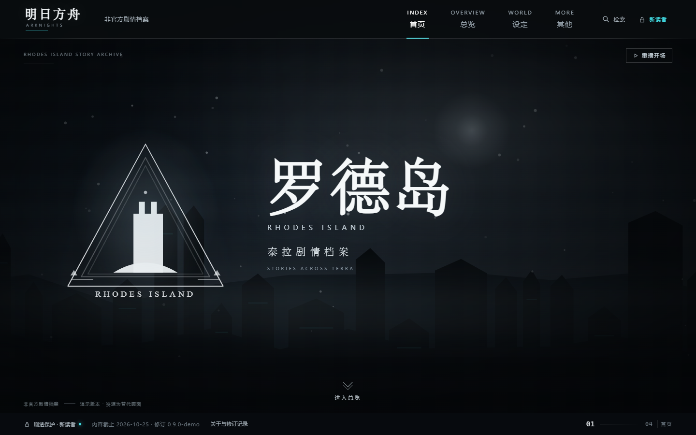
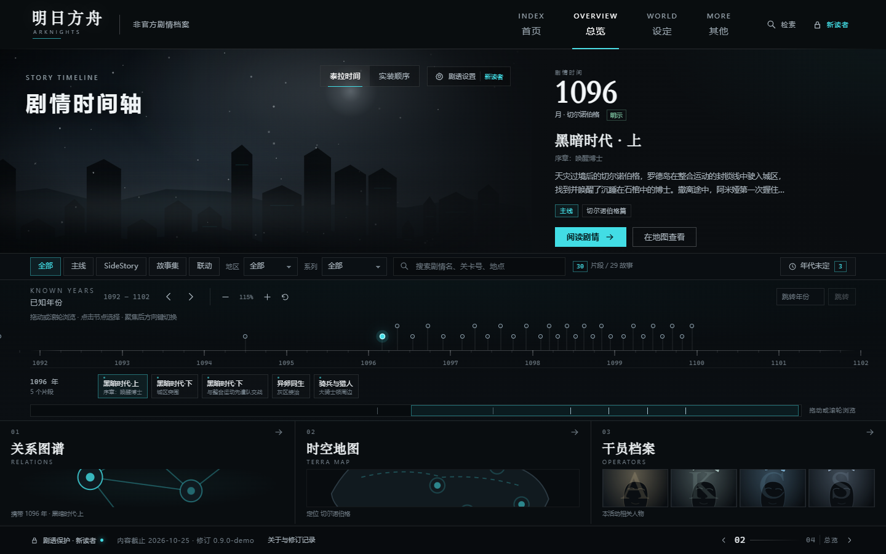
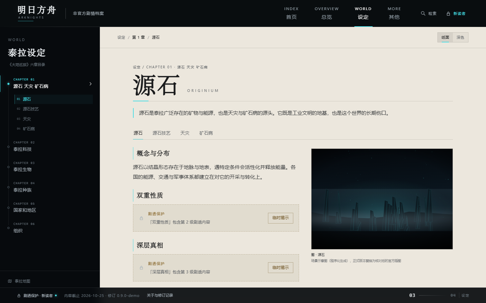
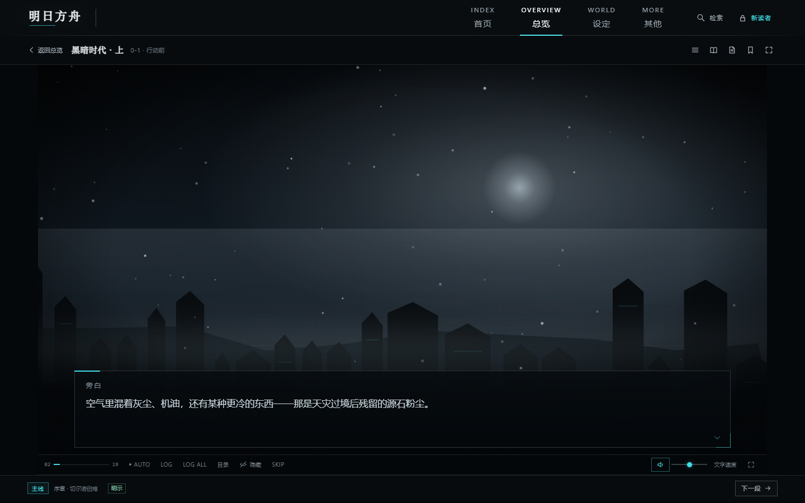
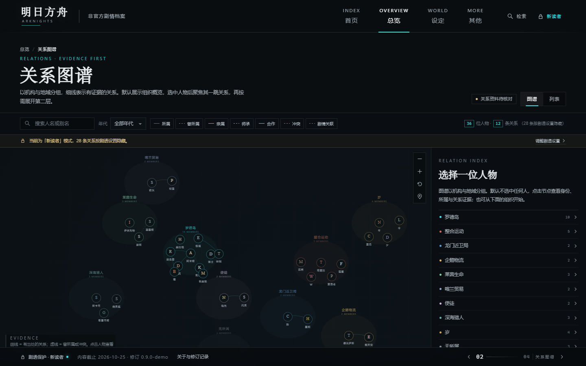
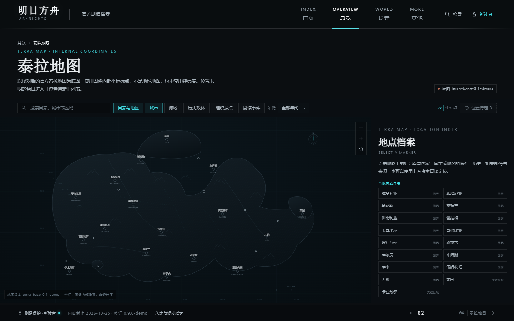

# ArkNights-Story

《明日方舟》非官方剧情档案 · 当前版本 v0.9.3

按《明日方舟剧情网站 需求与视觉方案 V1.1》实现的 Vite + React 单页应用：四个主页面、独立剧情播放器、关系图谱、泰拉地图、干员档案、六章世界观设定与媒体入口。

> 本项目是玩家整理的非官方演示站点，与鹰角网络及《明日方舟》官方无隶属关系。首页已采用真实游戏剧情 CG，总览保留现有活动档案图及来源；其余占位图、曲目、逐句脚本仍为**结构示例 / 程序化替代资源**。

## 本次更新 · 2026-10-27

首页开场与滚轮翻页已优化；当前首页采用 15-15 决战群像、明日方舟标题与官网 Logo。时间轴已增加阶段展开与剧情圆点，并取消全站剧透模式，详见 [时间轴更新说明](docs/TIMELINE_UPDATE_0_9_3.md)。此前的首页改动见 [首页优化记录](docs/HOME_UPDATE_20261027.md) 与 [15-15 背景及品牌更新](docs/HOME_BRAND_UPDATE_0_9_2.md)。下方截图保留上传项目的旧版界面，仅作原始布局参考。

## 界面预览

| 首页 · 巴别塔开场 | 总览 · 双排序时间轴 |
| --- | --- |
|  |  |

| 设定 · 六章阅读区 | 剧情播放器 |
| --- | --- |
|  |  |

| 关系图谱 | 泰拉地图 |
| --- | --- |
|  |  |

## 运行

```bash
pnpm install     # 或 npm install
pnpm dev         # 开发服务器，默认 http://localhost:5188
pnpm test        # 手势与镜片几何测试
pnpm build       # 生产构建，输出 dist/
pnpm build:pages # GitHub Pages 构建，输出 dist/，使用仓库子路径和 hash 路由
pnpm preview     # 预览构建结果
```

要求 Node.js 20.19+ 或 22.12+（以所用 Vite 8 的引擎范围为准）。技术栈：React 19 + React Router 7 + Vite 8，无 UI 框架依赖，样式为原生 CSS。

## 路由

| 页面 | 地址 |
| --- | --- |
| 首页（巴别塔开场） | `/home` |
| 总览（双排序时间轴） | `/overview` |
| 设定（六章） | `/world`、`/world/:entryId` |
| 其他（唱片 / 图集） | `/more` |
| 剧情播放器 | `/stories/:storyId/play/:chapterId` |
| 关系图谱 | `/relations` |
| 干员档案 / 人物档案 | `/operators`、`/people/:personId` |
| 泰拉地图 | `/map`、`/locations/:locationId` |
| 塞壬唱片 / 游戏图集 | `/music`、`/gallery` |

GitHub Pages 独立站点入口：<https://yakumo-sue.github.io/ArkNights-Story/>。工作流在每次推送到 `main` 后测试、构建并发布，使用 `/#/overview` 等 hash 地址以支持刷新，详见 [Pages 部署说明](docs/GITHUB_PAGES.md)。

普通 `pnpm build` 部署到其他静态平台时需要把未知路径回退到 `index.html`（Netlify/Vercel 的 SPA 重写；Nginx `try_files $uri /index.html`）。

## 已实现的需求要点

- **分页浏览**：四个主入口有独立地址、浏览器历史与当前页高亮；页脚常驻上一页 / 下一页按钮；滚轮或触摸在页面边缘按首页 → 总览 → 设定 → 其他翻页，惯性尾部不连续跨页，长文与内部滚动区域优先滚动。
- **巴别塔开场**：4.8 秒分段时间线（显影 → 停留 → 裂纹 → 镜面碎裂 → 罗德岛揭示 → 徽记左移 / 标题展开 → 箭头），镜面碎裂由 Canvas 2D 绘制：径向裂纹、预切割纹理缓存、三维旋转与透视投影、高光边与轻量冲击波；随时可跳过，同一会话只自动播放一次，支持重播；资源解码后统一启动，离开前台暂停；`prefers-reduced-motion` 直接显示静态首页。
- **两层时间轴**：泰拉时间 / 实装顺序切换；阶段竖线聚合该时期的全部片段，点击局部展开为剧情圆点，下方以大号名称列出全部片段。点击圆点或名称同步封面与概览，支持滚轮、拖拽、年份定位、缩放、键盘和返回总览。跨年片段进入相关阶段，年代未定保留独立入口。
- **时间标签**：每条时间标注「明示 / 推定 / 未定」，点击标签查看判定说明与证据。
- **直接阅读**：全站不设置剧透模式或内容遮罩，所有访客都能直接查看已收录的身份、关系、设定与图片；不受历史模式偏好影响。
- **剧情播放器**：背景 / 立绘 / 对话框 / 逐字显示、点击补全与推进、AUTO、SKIP、LOG、LOG ALL、章节目录、选项分支、文字速度、音量、隐藏 UI、全屏、书签与本机进度续读。
- **关系图谱**：组织分组概览、节点侧栏、一跳 / 二跳聚焦、年代筛选、连线图例、证据侧栏与可访问的列表视图。
- **泰拉地图**：图像内部坐标（非经纬度）、拖拽缩放、图层开关、年代筛选、地点搜索、位置待定列表、国家目录。
- **干员档案**：代号 / 别名检索、国家 / 组织 / 种族 / 首次登场 / 已读范围 / 职业 / 星级筛选、形态（本体与异格）关联。
- **六章设定**：左侧章节目录、词条标签页、纸面 / 深色阅读主题、关联剧情与人物地点、来源与修订记录。
- **媒体**：唱片分类与播放器、全局唯一音源与迷你控件、进入播放器自动暂停；图集分类、筛选与大图查看。
- **可达性**：键盘可达导航 / 时间轴 / 图谱节点 / 大图，焦点可见，减少动态效果与文字整句显示。

## 数据

`src/data/` 中为一份资料、多视图的数据结构：故事主卡与时间片段分开，人物与干员形态分开，关系带有效区间、出处与确定程度。修改数据后所有页面同步更新。

- `stories.js` 故事、章节、时间片段与示例逐句脚本（仅 2 个片段含脚本）
- `people.js` 人物、所属、干员形态
- `relations.js` 正式关系连线（含证据字段）
- `geography.js` 地点、地图坐标与图层、位置待定
- `world.js` 六章设定词条
- `media.js` 唱片与图集

时间、图片对应关系与正文仍需按方案规则复核；当前数据统一标记为「待核对」。

## 视觉资源说明

- 巴别塔 / 罗德岛徽记使用 `src/assets/opening/` 下的 PNG（由项目方提供），开场由 `components/OpeningCanvas.jsx` + `lib/fracture.js` 绘制；首页背景为 `public/assets/home/rhodes-final-battle-l.webp` 与 `rhodes-final-battle-r.webp`（主线 15-15《拒绝哀悼》行动后 CG `60_i11_2L/2R`，出处见 `src/data/homeMedia.js`）；导航使用 `public/assets/brand/arknights-official-logo.svg`（国服官网原始透明 Logo）；其余占位插图、角色头像仍为 SVG / CSS **程序化占位**：`components/Scene.jsx`（场景）、`Portrait.jsx`（头像）、`Marks.jsx`（其他徽记）。
- 总览主视觉使用 `public/assets/overview/` 下的本地封面，覆盖当前32个故事；24张来自 Arknights Terra Wiki，新增8张来自明日方舟官网。画面完整适应容器并保留来源，加载失败时显示明确提示；新封面来源见 `docs/cover-sources-0_9_3.json`。
- 时间轴先以阶段竖线聚合，再展开剧情圆点；点击圆点或名称切换主视觉；剧情全文、背景图与 BGM 未随站点打包，总览与播放器均提供 PRTS 对应条目的外链，正式导入需按活动/章节单独核对授权与体量。
- 徽记的正式授权与使用范围需在公开部署前确认；当前仅用于本地演示。
- 音频为 Web Audio 实时合成的环境音占位，用于验证「点击后才播放 / 同一时刻一个音源 / 可暂停」等规则。
- 正式资源到位后替换组件内的绘制层即可，页面结构无需改动。

## 目录结构

```
src/
  components/   场景、头像、页首页脚、播放器与通用 UI
  context/      阅读偏好、进度、音乐等全局状态（localStorage / sessionStorage）
  data/         剧情、人物、关系、地理、设定、媒体
  lib/          存储、音频引擎、随机、媒体查询与滚轮翻页
  pages/        各路由页面
  styles/       设计令牌与分层样式
```
